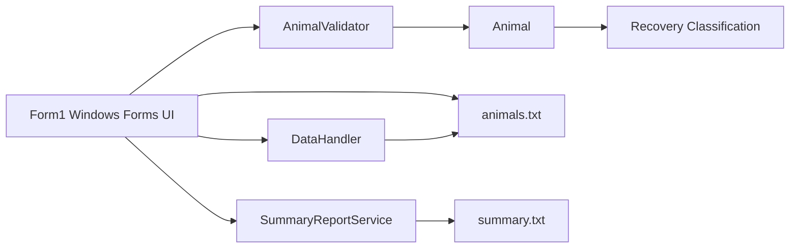
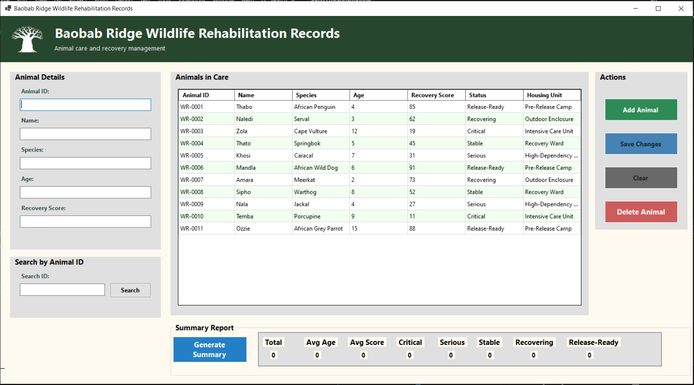

# PRG271 Baobab Ridge


A Windows Forms application for managing animal rehabilitation records at Baobab Ridge Wildlife Rehabilitation Centre. It validates, stores, updates, deletes, classifies and summarises animal records using text files.

## Team Members

| Member | Student number |
|---|---|
| Aman Harripersadh | `603758` |
| Mickayla Samuel | `[Add student number]` |
| Tanea Dhanjee | `[Add student number]` |
| Sintle Mlangeni | `[Add student number]` |

## Features

### Currently implemented

- Load animal records from `animals.txt`.
- Validate all animal fields and skip invalid file rows safely.
- Add new animals with unique IDs.
- Search for animals by ID.
- Select and update existing animals.
- Recalculate status and housing after recovery-score changes.
- Clear the input fields and exit edit mode.
- Delete one selected animal after confirmation.
- Display records in a read-only `DataGridView`.
- Generate summary statistics and save them to `summary.txt`.
- Handle common file-access errors without closing the application.

## Recovery Classification

| Recovery score | Status | Housing unit |
|---:|---|---|
| 0–19 | Critical | Intensive Care Unit |
| 20–39 | Serious | High-Dependency Ward |
| 40–59 | Stable | Recovery Ward |
| 60–79 | Recovering | Outdoor Enclosure |
| 80–100 | Release-Ready | Pre-Release Camp |

## Tech Stack

- **C# and .NET 8**
- **Windows Forms**
- **DataGridView**
- **Pipe-separated text-file storage**
- **Git and GitHub**

The project does not require a database, web service, environment variables or external packages.

## Architecture



### Application flow

1. The application loads and validates records from `animals.txt`.
2. Valid animals are displayed in their original file order.
3. Add and Update validate every field before saving.
4. Delete confirms the selected animal before rewriting the file.
5. Generate Summary calculates totals and averages and overwrites `summary.txt`.

## Project Structure

```text
PRG271-Baobab-Ridge/
├── README.md
├── .gitignore
└── PRG271-Baobab-Ridge/
    ├── Animal.cs
    ├── AnimalValidator.cs
    ├── DataHandler.cs
    ├── Form1.cs
    ├── Form1.AddEdit.cs
    ├── Form1Delete.cs
    ├── Form1.Designer.cs
    ├── Form1.resx
    ├── Program.cs
    ├── animals.txt
    ├── Services/
    │   └── SummaryReportService.cs
    ├── Properties/
    │   └── Resources.resx
    ├── PRG271-Baobab-Ridge.csproj
    └── PRG271-Baobab-Ridge.slnx
```

| File | Responsibility |
|---|---|
| `Animal.cs` | Defines animal properties and recovery classification. |
| `AnimalValidator.cs` | Validates user and file input. |
| `Form1.cs` | Loads animals and generates summary reports. |
| `Form1.AddEdit.cs` | Handles Add, Search, Update and Clear. |
| `Form1Delete.cs` | Handles selection validation and deletion. |
| `DataHandler.cs` | Removes a matching animal from the data file. |
| `SummaryReportService.cs` | Calculates, formats and saves summaries. |
| `Form1.Designer.cs` | Defines the form controls and layout. |

## Installation and Setup

### Prerequisites

- Windows 10 or later
- Visual Studio 2022 or later with the **.NET desktop development** workload
- .NET 8 SDK
- Git

### Clone the repository

```powershell
git clone https://github.com/harriperSoda/PRG271-Baobab-Ridge.git
cd PRG271-Baobab-Ridge
```

### Run with Visual Studio

1. Open `PRG271-Baobab-Ridge/PRG271-Baobab-Ridge.slnx`.
2. Build the solution.
3. Press `F5` or select **Start**.

### Run from the command line

```powershell
dotnet build .\PRG271-Baobab-Ridge\PRG271-Baobab-Ridge.csproj
dotnet run --project .\PRG271-Baobab-Ridge\PRG271-Baobab-Ridge.csproj
```

## Usage

1. Start the application to load the saved animals.
2. Enter valid details and select **Add Animal** to create a record.
3. Search by ID or select a grid row to load an animal for editing.
4. Select **Save Changes** to update it or **Clear** to leave edit mode.
5. Select a row and choose **Delete Animal** to remove it after confirmation.
6. Select **Generate Summary** to display statistics and save `summary.txt`.

## File Formats

### `animals.txt`

Each line stores one animal using seven pipe-separated fields:

```text
AnimalId|Name|Species|Age|RecoveryScore|Status|HousingUnit
```

Example:

```text
WR-0001|Thabo|African Penguin|4|85|Release-Ready|Pre-Release Camp
```

The application creates this file when missing and skips malformed or inconsistent rows.

### `summary.txt`

This human-readable report contains:

- Date and time generated
- Total number of animals
- Average age
- Average recovery score
- Number of animals in each status

The file is overwritten whenever a new summary is generated. Empty data displays averages as `N/A`.

## Screenshots




## Engineering Decisions

### Centralised validation

`AnimalValidator` applies the same validation rules when loading, adding and updating animals.

### Derived classification

Status and housing unit are calculated from the recovery score instead of being entered manually.

### Safe record management

The grid is read-only. Records can only be changed through validated Add, Update and Delete operations.

### Partial form classes

Form behaviour is separated into partial files for loading, add/edit actions and deletion while retaining one `Form1` class.

### Flat-file storage

Text files keep the project simple and satisfy the project requirements without requiring a database.

## Testing

The application has been tested manually for:

- Successful build and startup
- Valid and invalid file loading
- Field validation and focus
- Duplicate Animal IDs
- Adding and updating animals
- Status and housing recalculation
- Search success and not-found handling
- Clear behaviour
- Delete selection and confirmation
- Summary calculations and file generation
- Common file-access failures

Automated unit tests have not been added.

## Limitations and Future Improvements

- The application supports Windows only.
- Text files do not provide database transactions or concurrent-user support.
- File-loading logic remains inside `Form1`.
